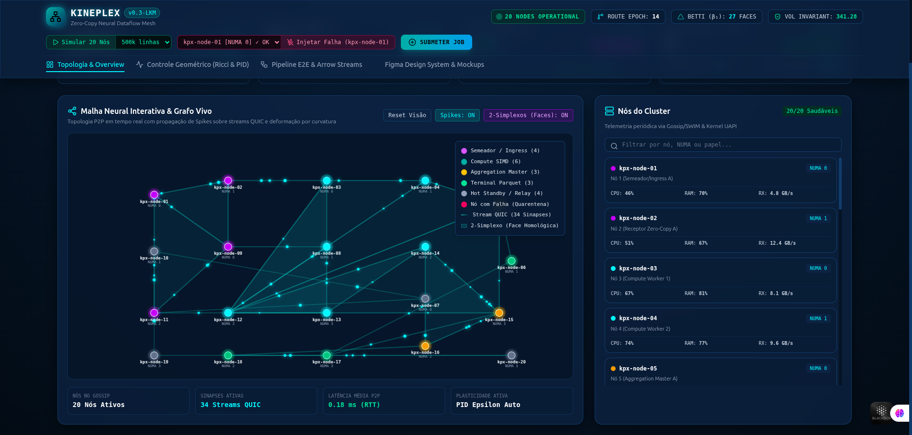
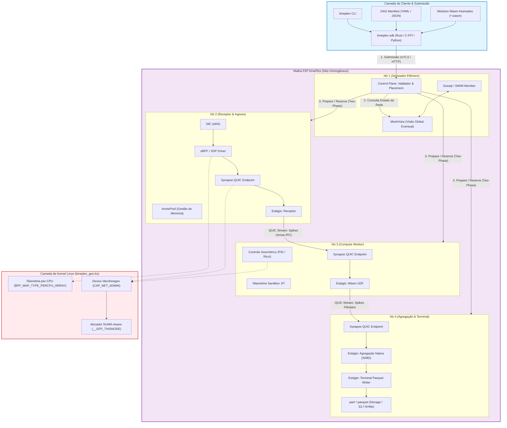
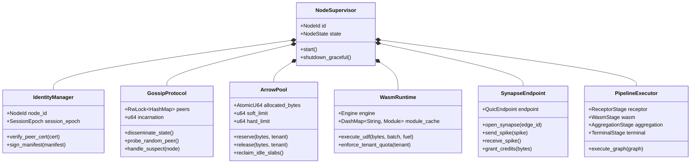
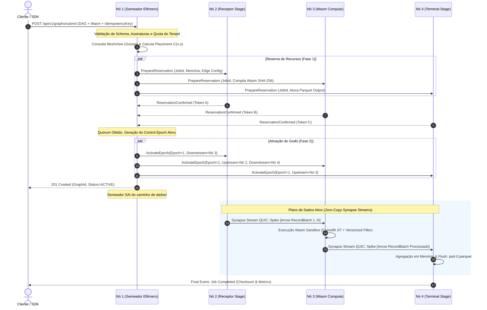
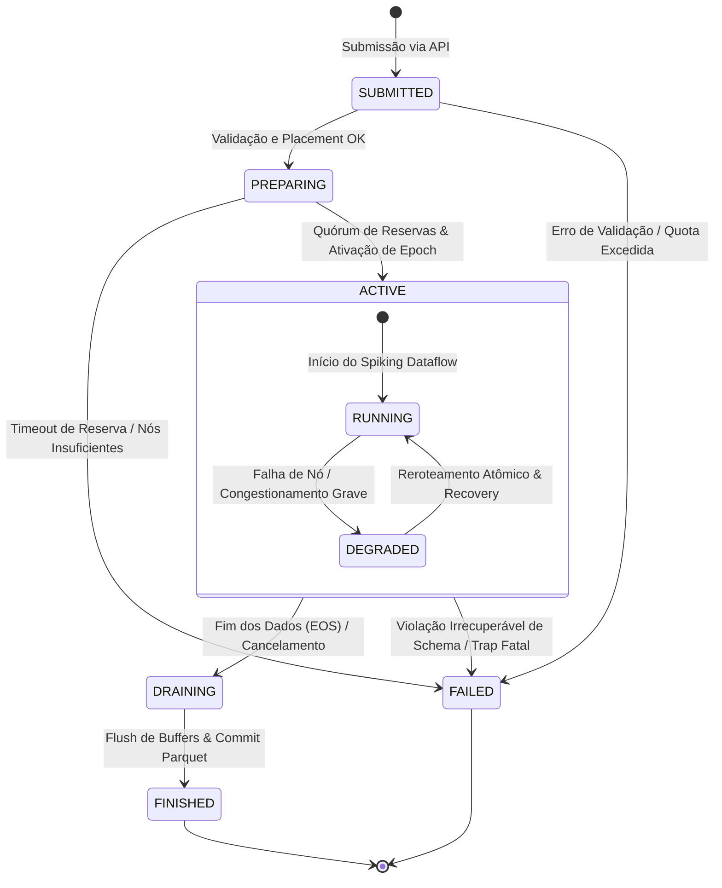
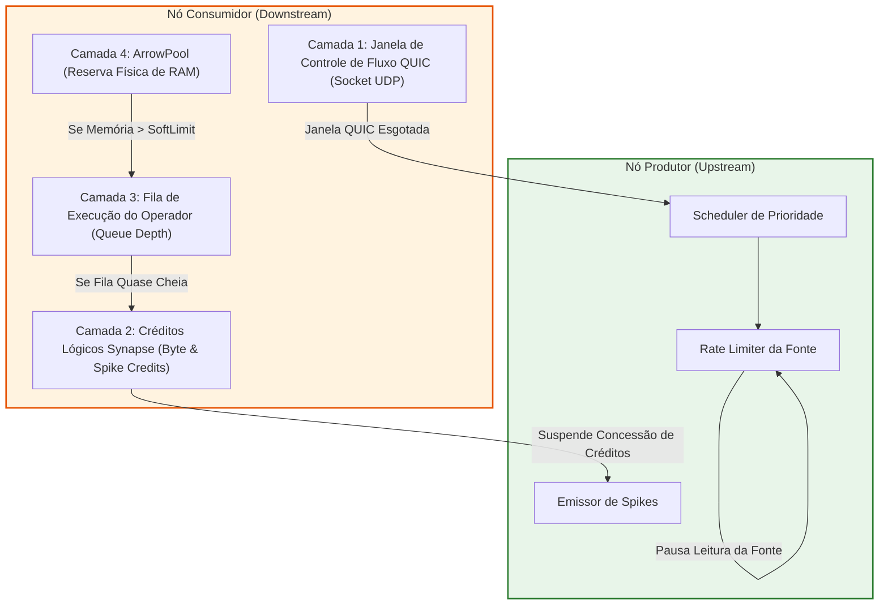
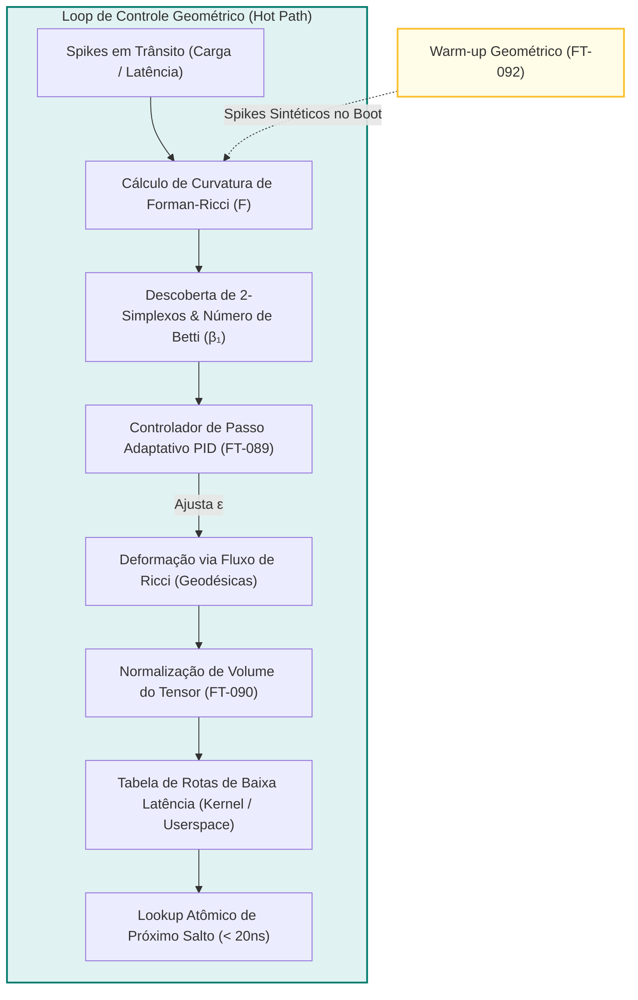
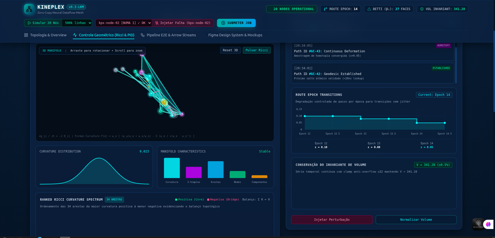

# KinePlex: Motor de Processamento Distribuído Zero-Copy via Malha Neural e Geometria Diferencial

[](https://www.rust-lang.org/)
[](https://arrow.apache.org/)
[](https://wasmtime.dev/)
[](./kineplex-kernel/)
[](./bpf/)
[](./COMPLETUDE.md)
[](./LICENSE)

---

<p align="center">
  
</p>
<p align="center">
  <em><strong>Portal KinePlex:</strong> Monitoramento visual distribuído de 20 nós em 4 domínios NUMA, topologia de rede, taxas de Spikes Arrow IPC e telemetria de latência em tempo real.</em>
</p>

---

## Sumário

1. [Sumário Executivo e Racional de Disrupção](#1-sumário-executivo-e-racional-de-disrupção)
   - [A Tese KinePlex](#a-tese-kineplex)
   - [Metáfora Biológica vs. Implementação Física](#metáfora-biológica-vs-implementação-física)
   - [KinePlex vs. Motores Tradicionais (Spark / Flink / MapReduce)](#kineplex-vs-motores-tradicionais-spark--flink--mapreduce)
2. [Visão Geral da Arquitetura do Sistema](#2-visão-geral-da-arquitetura-do-sistema)
   - [Os Quatro Planos Lógicos](#os-quatro-planos-lógicos)
   - [Diagrama de Arquitetura Global](#diagrama-de-arquitetura-global)
3. [Anatomia Interna de um Nó (`kineplex-node`)](#3-anatomia-interna-de-um-nó-kineplex-node)
   - [Componentes Supervisionados pelo Tokio](#componentes-supervisionados-pelo-tokio)
   - [Diagrama de Estrutura de Componentes de um Nó](#diagrama-de-estrutura-de-componentes-de-um-nó)
4. [Ciclo de Vida de um Job e o Semeador Efêmero](#4-ciclo-de-vida-de-um-job-e-o-semeador-efêmero)
   - [Coordenação Efêmera vs. Mestre Permanente](#coordenação-efêmera-vs-mestre-permanente)
   - [Heurística Determinística de Posicionamento](#heurística-determinística-de-posicionamento)
   - [Diagrama de Sequência de Submissão e Execução](#diagrama-de-sequência-de-submissão-e-execução)
5. [O Grafo Vivo (The Living Graph)](#5-o-grafo-vivo-the-living-graph)
   - [Separação Lógica vs. Física](#separação-lógica-vs-física)
   - [Máquina de Estados do Job](#máquina-de-estados-do-job)
6. [Protocolo Synapse & Spiking Dataflow](#6-protocolo-synapse--spiking-dataflow)
   - [Transporte QUIC (RFC 9000) e Multiplexação](#transporte-quic-rfc-9000-e-multiplexação)
   - [Framing do Spike (`SpikeHeader` e RecordBatches)](#framing-do-spike-spikeheader-e-recordbatches)
   - [Dinâmica de Acumulação e Disparo Adaptativo](#dinâmica-de-acumulação-e-disparo-adaptativo)
   - [Backpressure de Quatro Camadas](#backpressure-de-quatro-camadas)
7. [Subsistema de Memória Zero-Copy & Governança (ArrowPool)](#7-subsistema-de-memória-zero-copy--governança-arrowpool)
   - [A Fronteira Real do Zero-Copy](#a-fronteira-real-do-zero-copy)
   - [Governança Hierárquica com ArrowPool](#governança-hierárquica-com-arrowpool)
   - [Diagrama de Fluxo de Memória (NIC até CPU)](#diagrama-de-fluxo-de-memória-nic-até-cpu)
8. [Isolamento Seguro com WebAssembly (Wasmtime Sandbox)](#8-isolamento-seguro-com-webassembly-wasmtime-sandbox)
   - [Modelo de Isolamento e Execução Segura](#modelo-de-isolamento-e-execução-segura)
   - [Arrow C Data Interface & ABI Host-Wasm](#arrow-c-data-interface--abi-host-wasm)
   - [SDK e Macro Procedural `#[kineplex::synapse]`](#sdk-e-macro-procedural-kineplexsynapse)
9. [Controle Geométrico e Roteamento Deformável (FT-089 a FT-092)](#9-controle-geométrico-e-roteamento-deformável-ft-089-a-ft-092)
   - [Fundamentos: Fluxo de Ricci e Curvatura de Forman](#fundamentos-fluxo-de-ricci-e-curvatura-de-forman)
   - [FT-089: Controlador de Passo Adaptativo PID](#ft-089-controlador-de-passo-adaptativo-pid)
   - [FT-090: Normalização de Volume do Tensor Métrico](#ft-090-normalização-de-volume-do-tensor-métrico)
   - [FT-091: Descoberta de 2-Simplexos e Número de Betti](#ft-091-descoberta-de-2-simplexos-e-número-de-betti)
   - [FT-092: Aquecimento Geométrico (Topological Warm-up)](#ft-092-aquecimento-geométrico-topological-warm-up)
10. [Módulo de Kernel Linux & Aceleração de Rede (FT-093 a FT-096)](#10-módulo-de-kernel-linux--aceleração-de-rede-ft-093-a-ft-096)
    - [Arquitetura do Driver `kineplex_geo.ko` e UAPI `/dev/kinegeo`](#arquitetura-do-driver-kineplex_geoko-e-uapi-devkinegeo)
    - [FT-093: Alocação NUMA-Aware Estrita](#ft-093-alocação-numa-aware-estrita)
    - [FT-094: Telemetria XDP per-CPU com eBPF](#ft-094-telemetria-xdp-per-cpu-com-ebpf)
    - [FT-095: Ciclo de Vida do eBPF/XDP Desacoplado](#ft-095-ciclo-de-vida-do-ebpfxdp-desacoplado)
    - [FT-096: Segurança em Kernel e Capability Enforcement](#ft-096-segurança-em-kernel-e-capability-enforcement)
11. [Resiliência, Tolerância a Falhas e Plasticidade Sináptica](#11-resiliência-tolerância-a-falhas-e-plasticidade-sináptica)
    - [Modelo de Falhas e Blast Radius](#modelo-de-falhas-e-blast-radius)
    - [Plasticidade Sináptica e Reroteamento Atômico](#plasticidade-sináptica-e-reroteamento-atômico)
    - [Garantias de Entrega e Checkpointing](#garantias-de-entrega-e-checkpointing)
12. [Estrutura do Repositório e Crates](#12-estrutura-do-repositório-e-crates)
13. [Guia de Instalação, Compilação e Execução](#13-guia-de-instalação-compilação-e-execução)
    - [Pré-requisitos de Sistema](#pré-requisitos-de-sistema)
    - [Build do Workspace Rust](#build-do-workspace-rust)
    - [Build e Carga do Módulo de Kernel / XDP](#build-e-carga-do-módulo-de-kernel--xdp)
    - [Execução de Testes e Benchmarks](#execução-de-testes-e-benchmarks)
    - [Submissão de Jobs via CLI](#submissão-de-jobs-via-cli)
14. [Observabilidade, SLOs e Operação](#14-observabilidade-slos-e-operação)
    - [Métricas RED/USE e Dashboards Grafana](#métricas-reduse-e-dashboards-grafana)
    - [Matriz Oficial de SLOs e Error Budget](#matriz-oficial-de-slos-e-error-budget)
    - [Runbooks Operacionais](#runbooks-operacionais)
15. [Roadmap e Próximos Passos](#15-roadmap-e-próximos-passos)

---

## 1. Sumário Executivo e Racional de Disrupção

### A Tese KinePlex

O **KinePlex** é um motor distribuído de processamento contínuo e streaming de dados de ultra-baixa latência projetado para hardware moderno (CPUs multi-core, memórias NUMA, placas de rede de alta velocidade com XDP/eBPF e instruções vetoriais SIMD).

Os motores de computação analítica tradicionais (nascidos na era MapReduce e consolidados no Apache Spark e Apache Flink) foram arquitetados sob premissas de hardware do início dos anos 2000:
- O gargalo era o disco rotacional mecânico e a banda de rede restrita (1 GbE).
- A serialização em formatos orientados a linha (Java Serialization, Kryo, JSON) consumia parcelas aceitáveis da CPU diante do tempo de I/O.
- Arquiteturas centradas em um **Driver/Master Permanente** eram necessárias para orquestrar etapas estáticas (Map, Shuffle, Reduce).

Com redes de 25–100 GbE, interfaces NVMe e centenas de núcleos por servidor, **o gargalo migrou inteiramente para a CPU, a cópia de memória desnecessária e as pausas de Garbage Collection (GC)**. O KinePlex resolve essa restrição combinando:
1. **Rede Colunar Nativa (Apache Arrow IPC)**: Formato de memória canônico do trânsito ao repouso, eliminando conversões.
2. **Transporte Multiplexado Criptografado (QUIC / RFC 9000)**: Streams de dados independentes sem Head-of-Line Blocking entre partições.
3. **Isolamento Confiável de Código Arbitrário (WebAssembly via Wasmtime)**: Execução segura de UDFs compiladas JIT com limite estrito de memória e combustível (fuel).
4. **Coordenação Efêmera Descentralizada (Gossip/SWIM)**: Qualquer nó atua como Semeador, posiciona o plano de execução e sai do caminho crítico de dados.
5. **Roteamento Topológico Deformável (Geometria Diferencial & Fluxo de Ricci)**: A malha equilibra o fluxo de dados como uma variedade riemanniana discreta, mitigando congestionamento em microssegundos.
6. **Aceleração em Kernel Linux (NUMA-aware LKM + eBPF/XDP)**: Tratamento de telemetria e recepção de pacotes diretamente no subsistema de rede com alocação local de memória física.

---

### Metáfora Biológica vs. Implementação Física

Para facilitar o raciocínio arquitetural sobre sistemas dinâmicos, o KinePlex adota conceitos inspirados na neurociência, mantendo equivalência matemática e física rigorosa:

| Conceito KinePlex | Metáfora Biológica | Implementação Técnica Real |
| :--- | :--- | :--- |
| **Nó (`kineplex-node`)** | Neurônio | Processo supervisionado em Rust com Tokio, isolado em CPU/Memória. |
| **Sinapse (`SynapseEndpoint`)** | Sinapse | Stream QUIC unidirecional autenticado (TLS 1.3) sobre UDP com controle de fluxo dedicado. |
| **Spike (`ArrowData`)** | Potencial de Ação | Micro-lote colunar contendo um ou mais `RecordBatch` Apache Arrow com cabeçalho delimitador. |
| **Semeador (`Seeder`)** | Centro de Germinação | Papel efêmero assumido pelo nó receptor da submissão para calcular o placement do DAG e sair do caminho crítico. |
| **Plasticidade Sináptica** | Sinaptogênese / Poda | Reroteamento adaptativo de streams entre réplicas via migração atômica de `route_epoch`. |
| **Curvatura da Rede** | Densidade Sináptica | Curvatura de Forman-Ricci ponderada sobre a matriz de adjacência, controlada por algoritmo PID. |

---

### KinePlex vs. Motores Tradicionais (Spark / Flink / MapReduce)

```
+---------------------------------------------------------------------------------------------------------+
|                                      COMPARAÇÃO ARQUITETURAL                                           |
+--------------------------+------------------------------+-----------------------------------------------+
| Característica           | Apache Spark / Flink         | KinePlex v0.3                                 |
+--------------------------+------------------------------+-----------------------------------------------+
| Coordenação do Cluster   | Master / Driver Centralizado | Malha P2P Descentralizada (Gossip / SWIM)     |
| Ponto Único de Falha     | Driver / JobManager          | Nenhum (Semeador Efêmero)                    |
| Protocolo de Transporte  | TCP / gRPC / Netty           | Synapse sobre QUIC (Multiplexado UDP/TLS 1.3) |
| Head-of-Line Blocking    | Sim (ao compartilhar TCP)    | Não (streams QUIC isolados por partição)      |
| Formato de Memória       | JVM Heap / Tungsten / Row    | Apache Arrow Colunar Contíguo Puro (Zero-Copy)|
| Pausas de Runtime        | Garbage Collection (GC)      | Zero GC (Rust RAII + ArrowPool determinístico)|
| Execução de Código (UDF) | JVM / Python PySpark IPC     | WebAssembly Sandbox (Wasmtime JIT + Fuel)     |
| Adaptação a Falhas       | Reagendamento pesado no Master| Plasticidade local imediata via Route Epochs  |
| Kernel Bypass / Hardware | Geralmente espaço de usuário | Módulo Kernel NUMA + eBPF/XDP per-CPU         |
+--------------------------+------------------------------+-----------------------------------------------+
```

---

## 2. Visão Geral da Arquitetura do Sistema

### Os Quatro Planos Lógicos

O KinePlex é estruturado em quatro planos lógicos coordenados, implementados de forma desacoplada dentro do mesmo binário de nó ou módulo de kernel:

1. **Plano de Associação (Membership & Identity)**: Responsável pelo bootstrap de nós, emissão e validação de identidades criptográficas mTLS (`NetNodeId`), disseminação epidêmica via protocolo Gossip/SWIM e detecção probabilística de falhas de nós.
2. **Plano de Controle (Control & Scheduling)**: Responsável pela ingestão do DAG de execução, validação semântica de schemas Arrow, cálculo determinístico da função de custo de posicionamento (*placement*), reserva em duas fases de capacidade de memória/CPU e ativação sincronizada de épocas (*epochs*).
3. **Plano de Dados (Data Plane & Synapse Engine)**: Hot path do sistema. Executa o pipeline de quatro estágios (`Receptor -> Wasm -> Aggregation -> Terminal`), operando sobre streams QUIC, gerenciando o enquadramento de micro-lotes (*spikes*), aplicando backpressure de quatro camadas e materializando saídas Parquet.
4. **Plano Operacional (Telemetry, Geometry & Kernel)**: Coleta métricas RED/USE per-CPU no kernel e XDP, computa a curvatura métrica riemanniana da topologia de rede, executa o controlador PID adaptativo de rotas e exporta sinais via Prometheus e Grafana.

---

### Diagrama de Arquitetura Global



---

## 3. Anatomia Interna de um Nó (`kineplex-node`)

### Componentes Supervisionados pelo Tokio

Cada nó do cluster é uma instância do executável `kineplex-node`, orquestrado de forma totalmente assíncrona sob o runtime Tokio. A arquitetura interna é isolada em subsistemas desacoplados com supervisão individual de falhas:

```
+------------------------------------------------------------------------------------+
|                                 kineplex-node                                      |
+------------------------------------------------------------------------------------+
| [IdentityManager]   -> Chaves Ed25519, Certificados mTLS X.509, Session Epochs     |
| [Membership (SWIM)] -> Gossip epidêmico, Ping/Ack, Probes indiretos, Incarnations  |
| [MeshView]          -> Telemetria de nós, Capacidade de memória, RTT, Custo de rota|
| [JobRegistry]       -> Manifestos ativos, Leases de autoridade, Fencing tokens     |
| [SynapseEndpoint]   -> Listener QUIC multi-stream, Framing, Flow Control lógico    |
| [ArrowPool]         -> Slab allocator contíguo, Accounting por tenant, Soft/Hard   |
| [WasmRuntime]       -> Wasmtime Engine singleton, Cranelift JIT, Cache SHA-256     |
| [PipelineExecutor]  -> Coordenação dos estágios (Receptor, Wasm, Aggregation, Term)|
| [GeometricEngine]   -> Computação de Forman-Ricci, Controlador PID de epsilon      |
| [TelemetryExporter] -> Prometheus Metrics (/metrics), Snapshots do Kernel Driver   |
+------------------------------------------------------------------------------------+
```

---

### Diagrama de Estrutura de Componentes de um Nó



---

## 4. Ciclo de Vida de um Job e o Semeador Efêmero

### Coordenação Efêmera vs. Mestre Permanente

Diferente do Spark (cujo Driver vive durante toda a execução do job e se torna um gargalo e ponto único de falha), o KinePlex utiliza o modelo de **Semeador Efêmero (Ephemeral Seeder)**:

1. **Submissão Universal**: Qualquer nó do cluster pode receber a requisição de submissão do cliente via API REST/mTLS com uma chave de idempotência (`idempotency_key`).
2. **Papel de Semeador**: O nó que recebe a requisição assume o papel de Semeador exclusivamente durante a fase de planejamento e ativação.
3. **Snapshot do MeshView**: O Semeador consulta sua tabela local de Gossip para selecionar nós candidatos baseados em frescor da telemetria, afinidade de dados, carga de CPU e disponibilidade de memória no ArrowPool.
4. **Reserva em Duas Fases**:
   - Fase 1 (`PrepareReservation`): O Semeador solicita reserva de memória e compilação do Wasm diretamente aos nós selecionados.
   - Fase 2 (`Commit / Activate`): Após confirmação de todos os nós, o Semeador assina e emite o `control_epoch` de ativação.
5. **Saída do Caminho Crítico**: Uma vez que os nós iniciam o streaming de dados via Synapse, o Semeador **libera todos os recursos de controle e deixa o caminho crítico**. O grafo continua executando de forma totalmente autônoma.

---

### Heurística Determinística de Posicionamento

A seleção de nós para cada operador do DAG utiliza uma função de custo determinística $C(n, o)$ que impede disputas e empates aleatórios:

$$C(n, o) = w_c \cdot C_{cpu} + w_m \cdot C_{mem} + w_q \cdot C_{queue} + w_d \cdot C_{dist} + w_a \cdot C_{artifact} + P_{policy}$$

Onde:
- $C_{cpu}$: Carga atual de CPU normalizada do nó $n$.
- $C_{mem}$: Pressão de memória sobre o `ArrowPool` local.
- $C_{queue}$: Quantidade de spikes pendentes nas filas de entrada.
- $C_{dist}$: Latência de rede estimada (RTT) entre o nó anterior e o nó candidato $n$.
- $C_{artifact}$: Custo de cache do bytecode Wasm (0 se o nó já possui o módulo em cache SHA-256; 1 se precisa baixar pela rede).
- $P_{policy}$: Penalidade infinita ($\infty$) para nós que violam isolamento de tenant, capacidades de hardware requeridas (ex: falta de suporte SIMD AVX-512) ou restrições de zona de disponibilidade.

---

### Diagrama de Sequência de Submissão e Execução



---

## 5. O Grafo Vivo (The Living Graph)

### Separação Lógica vs. Física

No KinePlex, um **Job** submetido pelo usuário é um Grafo Acíclico Dirigido (**DAG**) lógico imutável. No entanto, a sua execução real na malha é denominada **Grafo Vivo (The Living Graph)**:
- Cada operador lógico é materializado em instâncias físicas identificadas pela tupla estável:
  $$\text{Vértice Físico} = (\text{job\_id}, \text{operator\_id}, \text{partition\_id}, \text{replica\_id}, \text{route\_epoch})$$
- As arestas físicas são canais QUIC independentes com controle de fluxo dedicado.
- A malha é **viva** porque rotas, partições e réplicas podem migrar dinamicamente para outros nós sem reiniciar o job, preservando o estado e a semântica de entrega.

---

### Máquina de Estados do Job



---

## 6. Protocolo Synapse & Spiking Dataflow

### Transporte QUIC (RFC 9000) e Multiplexação

O transporte de dados inter-nós utiliza o protocolo proprietário **Synapse**, implementado sobre **QUIC (Quick UDP Internet Connections)**:
- **Zero Head-of-Line Blocking**: Se um pacote UDP de uma partição específica for perdido na rede, apenas aquela partição/stream aguarda a retransmissão; todas as outras partições no mesmo socket continuam fluindo em velocidade de linha.
- **TLS 1.3 Mandatório Integrado**: Criptografia de ponta a ponta sem overhead adicional de túneis TLS clássicos.
- **Connection Migration**: Resiliência contra mudanças de IP e reconexões instantâneas de rede.

---

### Framing do Spike (`SpikeHeader` e RecordBatches)

O dado trafega em unidades lógicas denominadas **Spikes**. Cada Spike possui um cabeçalho binário compacto de tamanho fixo seguido pelo stream de dados contíguo no padrão Arrow IPC:

```
+---------------------------------------------------------------------------------------+
|                                    SPIKE FRAME                                        |
+-------------------+--------------------+--------------------+-------------------------+
| Protocol Version  | Flags (16-bit)     | Header Len (16-bit)| Payload Len (32-bit)    |
| (16-bit)          | [EOS, BARRIER, ..] |                    |                         |
+-------------------+--------------------+--------------------+-------------------------+
| Job ID (UUIDv4 - 128-bit)              | Edge ID (UUIDv4 - 128-bit)                   |
+----------------------------------------+----------------------------------------------+
| Partition ID (32-bit)                  | Route Epoch (64-bit Monotonic)               |
+----------------------------------------+----------------------------------------------+
| Sequence Number (64-bit Monotonic)     | Schema Fingerprint (64-bit SHA-256 Trunc)    |
+----------------------------------------+----------------------------------------------+
| Batch Count (16-bit)                   | Codec (8-bit: None/LZ4/ZSTD) | Reserved (8b) |
+----------------------------------------+----------------------------------------------+
| CRC32C Checksum (32-bit)               | OpenTelemetry Trace Context (128-bit TraceID)|
+----------------------------------------+----------------------------------------------+
|                    PAYLOAD ARROW IPC (RecordBatches Contíguos)                       |
|   [Schema Message] -> [RecordBatch 1 Message] -> ... -> [RecordBatch N Message]       |
+---------------------------------------------------------------------------------------+
```

---

### Dinâmica de Acumulação e Disparo Adaptativo

Ao contrário de sistemas puramente orientados a lote (que esperam centenas de megabytes) ou orientados a tupla unitária (que pagam custo de syscall para cada evento), o **Spiking Dataflow** acumula micro-lotes dinamicamente no estágio receptor.

Um Spike é imediatamente **disparado** para execução quando a **primeira** das seguintes condições for satisfeita:

$$\text{Trigger} = (B_{accum} \ge B_{target}) \lor (t - t_0 \ge T_{max}) \lor (P_{mem} \ge M_{soft}) \lor \text{Flag}_{barrier}$$

```
                                CRITÉRIOS DE DISPARO (SPIKE TRIGGER)
    
     [Bytes Acumulados] >= B_target (ex: 64 KiB)   -----> [ DISPARO IMEDIATO ]
                                                                ^
     [Tempo do Item Mais Antigo] >= T_max (ex: 5ms) -----> [ DISPARO POR TIMEOUT ]
                                                                ^
     [Pressão de Memória] >= M_soft               -----> [ DISPARO POR PRESSÃO ]
                                                                ^
     [Flag Semântica] (Fim de Janela / Checkpoint) -----> [ DISPARO DE BARREIRA ]
```

---

### Backpressure de Quatro Camadas

Para garantir que a velocidade do produtor nunca exceda a capacidade do consumidor (evitando travamentos por Out of Memory - OOM), o KinePlex aplica uma barreira de controle coordenada em quatro camadas:



---

## 7. Subsistema de Memória Zero-Copy & Governança (ArrowPool)

### A Fronteira Real do Zero-Copy

No KinePlex, a afirmação de **Zero-Copy** é tratada com rigor de engenharia:
> *"Uma placa de rede nunca transfere ponteiros válidos de memória virtual entre processos distintos. Portanto, zero-copy significa a eliminação absoluta de cópias evitáveis de payload entre estágios de software e preservação de buffers imutáveis compartilhados via contadores de referência (`Arc<Buffer>`)."*

```
                                  MAPA DA FRONTEIRA DE CÓPIA
+-------------------+----------------------------------------------------+---------------------+
| Estágio           | O que acontece fisicamente                         | Cópia Evitada?      |
+-------------------+----------------------------------------------------+---------------------+
| NIC -> Kernel     | DMA grava frames Ethernet no anel RX               | Zero cópias de CPU  |
| Kernel -> Socket  | eBPF / XDP redireciona dados para ring buffer      | Zero cópias extras  |
| QUIC Transport    | Descriptografia AEAD TLS 1.3 in-place no buffer     | 1 cópia criptográfica|
| Synapse Framing   | Leitura de offsets e validação de schema metadata  | Zero cópias (Slice) |
| Arrow Decoder     | Mapeamento de ponteiros de arrays colunares        | Zero cópias (Mapeado)|
| Projeção / Slice  | Seleção de colunas e fatiamento horizontal         | Zero cópias (Arc)   |
| Wasm Guest FFI    | Compartilhamento via Arrow C Data Interface        | Zero cópias (Pointer)|
| Wasm Linear Mem   | Isolamento de segurança de memória Wasm (sandbox)  | Cópia segura p/ guest|
| Escrita Parquet   | Dicionários e compressão de páginas snappy/zstd    | Cópia de encoding   |
+-------------------+----------------------------------------------------+---------------------+
```

---

### Governança Hierárquica com ArrowPool

O alocador de memória `ArrowPool` gerencia cotas estritas em níveis hierárquicos:
- **Limite por Nó**: Teto absoluto do processo (`cgroup` aware).
- **Limite por Tenant**: Isolamento estrito de múltiplos usuários.
- **Limite por Job**: Impede que um job descontrolado afete jobs vizinhos.
- **Limite por Operador**: Controle fino sobre agregações e buffers de ordenação.

Quando o uso atinge o **Soft Limit (80%)**, o nó entra em modo reativo:
1. Esvazia caches de módulos Wasm frios.
2. Força o disparo antecipado de micro-lotes menores.
3. Diminui a concessão de créditos Synapse no plano de rede.

Ao atingir o **Hard Limit (95%)**, o nó recusa novos `PrepareReservation` e entra em quarentena temporária no Gossip.

---

### Diagrama de Fluxo de Memória (NIC até CPU)

```mermaid
flowchart LR
    NIC["Placa de Rede (NIC)\nAnel RX"] -->|DMA Direto| NUMA_PAGE["Página NUMA Local\n(__GFP_THISNODE)"]
    NUMA_PAGE -->|XDP Redirect| XDP_RING["XDP / eBPF Ring Buffer\n(per-CPU)"]
    XDP_RING -->|io_uring / Socket| QUIC_DEC["QUIC Engine\n(Descriptografia TLS)"]
    QUIC_DEC -->|Zero-Copy Slice| ARROW_BATCH["RecordBatch Arrow\n(Arc<Buffer>)"]
    
    subgraph HostPipeline["Pipeline em Host (Rust)"]
        ARROW_BATCH --> PROJ["Projeção de Colunas\n(Reutilização de Ponteiro)"]
        PROJ --> FFI_EXPORT["Arrow C Data Interface\n(FFI_ArrowArray struct)"]
    end

    subgraph GuestSandbox["Sandbox Wasmtime"]
        FFI_EXPORT -->|Import FFI| WASM_MEM["Linear Memory Wasm\n(Sandboxed Execution)"]
        WASM_MEM --> KERNEL_SIMD["Kernels Vetorizados\n(AVX2 / AVX-512)"]
    end

    KERNEL_SIMD -->|Resultado Filtrado| ARROW_OUT["RecordBatch de Saída\n(Alocado no ArrowPool)"]
    ARROW_OUT --> PARQUET_WRITER["Terminal Stage:\nParquet Writer"]

    classDef hw fill:#cfd8dc,stroke:#37474f,stroke-width:2px;
    classDef host fill:#e3f2fd,stroke:#1565c0,stroke-width:2px;
    classDef guest fill:#ede7f6,stroke:#4a148c,stroke-width:2px;
    class NIC,NUMA_PAGE,XDP_RING hw;
    class HostPipeline,QUIC_DEC,ARROW_BATCH,ARROW_OUT,PARQUET_WRITER host;
    class GuestSandbox,WASM_MEM,KERNEL_SIMD guest;
```



---

## 8. Isolamento Seguro com WebAssembly (Wasmtime Sandbox)

### Modelo de Isolamento e Execução Segura

O KinePlex permite que analistas e desenvolvedores enviem código arbitrário (User-Defined Functions - UDFs) diretamente para a malha. Para garantir a estabilidade do nó hospedeiro:
- **Cranelift JIT Compiler**: Compilação para código de máquina nativo em tempo de carregamento com verificações rigorosas de limites de instrução.
- **Consumo de Combustível (Fuel Metering)**: Cada execução de UDF recebe um orçamento de *fuel* (ex: 1.000.000 unidades). Loops infinitos consomem o combustível e disparam um **Trap limpo** no Wasmtime sem travar a thread Rust.
- **Isolamento de Memória Linear**: Cada instância Wasm possui teto máximo de memória (ex: 64 MiB a 512 MiB). Tentativas de alocação além do teto retornam erro determinístico.
- **WASI Totalmente Desabilitado**: A UDF não possui permissões para abrir arquivos no disco, acessar a rede ou ler variáveis de ambiente do servidor host.

---

### Arrow C Data Interface & ABI Host-Wasm

Para transferir dados entre o host Rust e o guest Wasm sem pagar o custo de serialização JSON ou Protobuf, o KinePlex utiliza a especificação padronizada **Arrow C Data Interface**:

```c
// Definição da ABI Arrow C Data Interface exportada para o guest
struct FFI_ArrowArray {
    int64_t length;
    int64_t null_count;
    int64_t offset;
    int64_t n_buffers;
    int64_t n_children;
    const void** buffers;
    struct FFI_ArrowArray** children;
    struct FFI_ArrowDictionary* dictionary;
    void (*release)(struct FFI_ArrowArray*);
    void* private_data;
};
```

O host instancia a estrutura `FFI_ArrowArray`, mapeia os ponteiros físicos do buffer Arrow para dentro do espaço de endereçamento do Wasm guest e invoca a função `kp_process`.

---

### SDK e Macro Procedural `#[kineplex::synapse]`

Escrever uma UDF de alto desempenho no KinePlex é tão simples quanto escrever uma função Rust idiomática:

```rust
use kineplex_sdk::prelude::*;

/// UDF de detecção de anomalias em telemetria industrial
#[kineplex::synapse(
    input = "sensor_events_v1",
    output = "sensor_anomalies_v1",
    deterministic = true,
    memory = "128MiB",
    fuel = 500_000
)]
pub fn detect_anomalies(batch: RecordBatch, ctx: &Context) -> Result<RecordBatch> {
    // 1. Extração de colunas com tipos nativos Arrow
    let sensor_ids = batch.column_by_name("sensor_id")
        .and_then(|c| c.as_any().downcast_ref::<StringArray>())
        .ok_or_else(|| Error::invalid_schema("Coluna sensor_id ausente"))?;
        
    let temperatures = batch.column_by_name("temperature")
        .and_then(|c| c.as_any().downcast_ref::<Float64Array>())
        .ok_or_else(|| Error::invalid_schema("Coluna temperature ausente"))?;

    // 2. Parâmetro configurado dinamicamente via submissão
    let temp_threshold = ctx.param_f64("max_temp").unwrap_or(85.0);

    // 3. Aplicação de predicado vetorizado (SIMD)
    let predicate = arrow::compute::cmp::gt(temperatures, &Float64Array::from(vec![temp_threshold; batch.num_rows()]))?;
    
    // 4. Filtragem do RecordBatch sem cópia de strings
    let filtered_batch = arrow::compute::filter_record_batch(&batch, &predicate)?;

    Ok(filtered_batch)
}
```

---

## 9. Controle Geométrico e Roteamento Deformável (FT-089 a FT-092)

### Fundamentos: Fluxo de Ricci e Curvatura de Forman

O roteamento adaptativo do KinePlex modela a malha de rede como um complexo celular geométrico no qual o tráfego de dados deforma a métrica local:
- Se uma conexão sináptica entre o Nó $A$ e o Nó $B$ acumula pacotes ou latência, sua **Curvatura de Forman-Ricci** $\mathbf{F}(e)$ diminui (torna-se negativa), sinalizando estrangulamento.
- O sistema aplica uma versão discreta do **Fluxo de Ricci**:
  $$\frac{d g_{ij}}{dt} = -2 R_{ij}$$
  deformando continuamente os caminhos de menor resistência (as **geodésicas** da rede) para desviar o fluxo antes que ocorram descartes de pacotes.

---

### FT-089: Controlador de Passo Adaptativo PID

A deformação contínua de rotas depende de um tamanho de passo $\varepsilon$. Se $\varepsilon$ for estático, a rede oscila violentamente entre caminhos alternativos (efeito ping-pong). O controlador PID integrado ajusta $\varepsilon$ dinamicamente:

$$e(t) = 0 - \Delta \text{Curvature}$$
$$\varepsilon(t) = \varepsilon(t-1) + K_p \cdot e(t) + K_i \int e(t) dt + K_d \frac{de(t)}{dt}$$

```rust
// kineplex-core/src/geometry.rs
pub struct AdaptiveStepController {
    kp: f64, ki: f64, kd: f64,
    prev_error: f64, integral: f64,
    epsilon: f64, epsilon_min: f64, epsilon_max: f64,
}
```
- **Convergência**: Quando a rede atinge estabilidade, o controlador reduz $\varepsilon$ para evitar oscilações micro-estruturais.

---

### FT-090: Normalização de Volume do Tensor Métrico

O Fluxo de Ricci tende a expandir espaços negativamente curvados e contrair espaços positivos. Sem controle, os pesos tenderiam a infinito ou zero, causando **Integer Overflow** nos tensores mantidos pelo driver de kernel:
- O normalizador `MetricTensorNormalizer` preserva a soma de volume invariante da malha:
  $$\sum_{(u, v) \in E} w(u, v) = V_0 \quad (\text{Volume Constante})$$
- Os valores são normalizados e limitados a registradores inteiros `u32` no hardware bare-metal.

---

### FT-091: Descoberta de 2-Simplexos e Número de Betti

Analisar apenas conexões ponto a ponto (1-simplexos) é insuficiente para distinguir nós congestionados de **buracos topológicos** (partições lógicas de rede):
- O algoritmo `Simplex2Discoverer` detecta ciclos de tamanho 3 (triângulos fechados / 2-simplexos).
- Calcula o **Primeiro Número de Betti** ($\beta_1$):
  $$\beta_1 = E - V + F$$
  onde $E$ é o número de arestas, $V$ o número de nós e $F$ o número de faces triangulares. Um $\beta_1 > 0$ identifica partitions topológicas no cluster, alertando o scheduler para não tentar rotas impossíveis.

---

### FT-092: Aquecimento Geométrico (Topological Warm-up)

Na inicialização do cluster, sem fluxo de dados prévio, os tensores métricos iniciam zerados. Injetar subitamente gigabytes de dados causaria saltos caóticos de rota no primeiro segundo:
- O motor `GeometricWarmup` dispara **Spikes Sintéticos** (cabeçalhos sem payload Arrow pesado).
- A malha mede a convergência de curvatura inicial.
- As sinapses só aceitam tráfego operacional real após a variância métrica cair abaixo do limiar de convergência (`variance < convergence_threshold`).

---

### Diagrama do Loop de Controle Geométrico



---

## 10. Módulo de Kernel Linux & Aceleração de Rede (FT-093 a FT-096)

### Arquitetura do Driver `kineplex_geo.ko` e UAPI `/dev/kinegeo`

Para cargas de missão crítica que operam abaixo de milissegundos, o KinePlex inclui um módulo de kernel Linux out-of-tree (`kineplex_geo.ko`) e programa XDP complementar em C:

```
+-----------------------------------------------------------------------------------------+
|                                ARQUITETURA DE KERNEL & DRIVER                           |
+-----------------------------------------------------------------------------------------+
| [Userspace App] -> Abre /dev/kinegeo (Exige CAP_NET_ADMIN)                              |
|                 -> ioctl(KINEPLEX_GEO_IOC_GET_INFO) -> Lê NUMA Node, Tensor Order       |
|                 -> ioctl(KINEPLEX_GEO_IOC_GET_TELEMETRY) -> Snapshot Agregado per-CPU   |
|                 -> mmap() -> Mapeia páginas NUMA locais do Tensor Métrico               |
| [XDP Loader]    -> Anexa bpf/kineplex_geo_xdp.bpf.o na interface de rede (ex: eth0)     |
| [XDP Program]   -> Atualiza estatísticas no mapa BPF_MAP_TYPE_PERCPU_ARRAY (Zero Lock)  |
| [Kernel Module] -> Valida dev_to_node(eth0) e aloca via __GFP_THISNODE                  |
+-----------------------------------------------------------------------------------------+
```

---

### FT-093: Alocação NUMA-Aware Estrita

Acesso a memórias de nós NUMA remotos introduz penalidades severas de latência e saturação do barramento QPI/UPI. O arquivo `kineplex_geo_numa.c`:
1. Identifica o nó NUMA físico vinculado à placa de rede: `dev_to_node(&pdev->dev)`.
2. Se a NIC retornar `NUMA_NO_NODE`, a carga do módulo é **rejeitada com `-ENODEV`** (sem fallback silencioso para memória remota).
3. Todas as páginas de buffers compartilhados são alocadas com flags restritas:
   ```c
   alloc_pages_node(ctx->numa_node, GFP_KERNEL | __GFP_THISNODE | __GFP_ZERO, order);
   ```

---

### FT-094: Telemetria XDP per-CPU com eBPF

Para monitorar milhões de pacotes por segundo sem concorrência de cache-line (*cache-line bouncing*):
- O programa XDP (`bpf/kineplex_geo_xdp.bpf.c`) utiliza um mapa do tipo `BPF_MAP_TYPE_PERCPU_ARRAY`.
- Cada fila RX da placa de rede roda em um CPU isolado e atualiza exclusivamente seu próprio slot de memória em registradores de 64 bits.
- O driver consolida o snapshot no caminho de controle sem interromper o processamento de rede.

---

### FT-095: Ciclo de Vida do eBPF/XDP Desacoplado

O utilitário `tools/kineplex_geo_loader.c` gerencia o attach/detach do programa XDP:
- O `bpf_link` **não é pinado** no bpffs.
- Ao encerrar o processo (inclusive via `SIGTERM`, `SIGINT` ou crash), o descritor de arquivo fecha e o kernel desanexa automaticamente o programa XDP da interface de rede, prevenindo programas zumbis.
- O loader mantém `/dev/kinegeo` aberto durante toda a vida útil; isso impede um `rmmod` acidental do módulo enquanto o XDP estiver operacional.

---

### FT-096: Segurança em Kernel e Capability Enforcement

O driver `/dev/kinegeo` adota política de privilégio mínimo e *deny-by-default*:
- Todas as operações (`open`, `ioctl`, `mmap`, `uring_cmd`) exigem expressamente a capacidade `CAP_NET_ADMIN`:
  ```c
  if (!capable(CAP_NET_ADMIN))
      return -EPERM;
  ```
- O callback `uring_cmd` para `io_uring` retorna `-EOPNOTSUPP` por padrão para opcodes não aprovados, bloqueando vetores de injeção em chamadas assíncronas do kernel.

---

## 11. Resiliência, Tolerância a Falhas e Plasticidade Sináptica

### Modelo de Falhas e Blast Radius

O KinePlex foi concebido sob a premissa de que falhas em sistemas distribuídos são eventos cotidianos, e não anomalias catastróficas:

```
+------------------------------------------------------------------------------------------+
|                                    MATRIZ DE RESILIÊNCIA                                 |
+--------------------------+------------------------------+--------------------------------+
| Cenário de Falha         | Blast Radius                 | Estratégia de Mitigação        |
+--------------------------+------------------------------+--------------------------------+
| Desconexão de Stream     | Única Sinapse / Partição     | Reconexão QUIC automática;      |
|                          |                              | Reenvio de Spikes não confirm. |
+--------------------------+------------------------------+--------------------------------+
| Nó com Lentidão (Straggler)| Operador Local             | Backpressure aciona Reroute;   |
|                          |                              | Nova réplica assume o fluxo.   |
+--------------------------+------------------------------+--------------------------------+
| Queda Súbita de Nó (Crash)| Operadores Hospedados       | Gossip detecta (SUSPECT/DEAD); |
|                          |                              | Semeador/Peers migram epoch.   |
+--------------------------+------------------------------+--------------------------------+
| Trap em UDF Wasm         | Spike Corrente               | Trap capturado; Reenvio ou     |
| (Loop / OOM / Divisão 0) |                              | Descarte para Dead-Letter.     |
+--------------------------+------------------------------+--------------------------------+
| Corrupção de Schema Arrow| Sinapse Específica           | NACK imediato; Fechamento do   |
|                          |                              | stream e alerta estruturado.   |
+--------------------------+------------------------------+--------------------------------+
```

---

### Plasticidade Sináptica e Reroteamento Atômico

Quando um nó downstream falha ou atinge exaustão de recursos, o nó upstream executa a **Plasticidade Sináptica**:
1. Congela o envio e registra o último número de sequência confirmado (`last_ack_seq`).
2. Seleciona um nó substituto previamente preparado no mesmo `route_set`.
3. Incrementa o `route_epoch` e abre um novo stream QUIC.
4. Reenvia os spikes não confirmados (`seq > last_ack_seq`).
5. O downstream deduplica automaticamente os spikes utilizando bitmaps indexados pelo `route_epoch`.

---

### Garantias de Entrega e Checkpointing

O KinePlex oferece três modalidades de entrega por aresta no DAG:
- **Best Effort**: Sem retransmissões no nível de aplicação (ideal para telemetria métrica descartável).
- **At Least Once**: ACKs de confirmação após processamento do Spike; retransmissões em caso de falha.
- **Effectively Once**: At Least Once combinado com deduplicação rigorosa de sequência e sinks idempotentes (ex: escrita atômica em arquivos Parquet com chave única).

Para operadores com estado (*stateful*), barreiras periódicas (`CheckpointBarrier`) percorrem o fluxo de dados em paralelo com os Spikes, persistindo instantâneos consistentes (`StateRef`) em armazenamento durável.

---

## 12. Estrutura do Repositório e Crates

A base de código do KinePlex está organizada em um workspace modular Cargo e componentes nativos de baixo nível:

```
KinePlex/
├── Cargo.toml                    # Configuração raiz do Workspace Rust
├── COMPLETUDE.md                 # Matriz oficial de features FT-071..FT-096 e cobertura
├── 2026-09-19-kineplex-design.pdf# Especificação técnica original (50 páginas)
│
├── kineplex-core/                # Motor central e tipos fundamentais
│   ├── src/
│   │   ├── lib.rs                # GraphId, Stage, Status, ExecutionResult
│   │   ├── data.rs               # ArrowData, IPC Reader/Writer, Estágios do Pipeline
│   │   ├── graph.rs              # GraphStore, Idempotência e DAGs distribuídos
│   │   ├── wasm.rs               # WasmRuntime, Sandbox Wasmtime, Cotas por Tenant
│   │   ├── geometry.rs           # FT-089 (PID), FT-090 (Norm), FT-091 (Simplex), FT-092
│   │   ├── metrics.rs            # Coletor de Métricas e Contratos de SLO
│   │   └── error.rs              # Tipos de erro estruturados CoreError
│   └── tests/
│       └── local_perf.rs         # Teste E2E de performance distribuída e Parquet
│
├── kineplex-net/                 # Camada de rede e protocolos de comunicação
│   ├── src/
│   │   ├── lib.rs                # NetNodeId, NetworkAddress, ConnectionStatus
│   │   ├── gossip.rs             # Protocolo Gossip/SWIM, Probes e Detecção de Falhas
│   │   ├── routing.rs            # Tabela de roteamento e resolução de próximos saltos
│   │   └── protocol.rs           # Contratos versionados de mensagens (FT-077)
│   └── Cargo.toml
│
├── kineplex-node/                # Daemon do Nó e Plano de Controle
│   ├── src/
│   │   ├── lib.rs                # ClusterManager, NodeState, Capacity
│   │   ├── control.rs            # NodeControl, Submissão, Autenticação e Quotas
│   │   └── execution.rs          # PipelineExecutor (Receptor -> Wasm -> Agg -> Term)
│   └── Cargo.toml
│
├── kineplex-sdk/                 # SDK do Desenvolvedor de Aplicações
│   ├── src/
│   │   ├── lib.rs                # Exports e versão do SDK
│   │   ├── client.rs             # KinePlexClient (Submit, Status, Cancel via API)
│   │   └── types.rs              # DTOs de submissão e respostas
│   └── Cargo.toml
│
├── kineplex-sdk-macros/          # Macros Procedurais Rust
│   ├── src/lib.rs                # Macro #[kineplex::synapse] para geração de UDFs
│   └── Cargo.toml
│
├── kineplex-cli/                 # Utilitário de Linha de Comando (CLI)
│   ├── src/main.rs               # Comandos: submit, status, cancel, list
│   └── Cargo.toml
│
├── kineplex-kernel/              # Módulo de Kernel Linux (Out-of-Tree LKM)
│   ├── Makefile                  # Build contra kernel headers locais
│   ├── include/uapi/linux/       # UAPI oficial (kineplex_geo.h)
│   └── src/
│       ├── kineplex_geo_main.c   # Char device /dev/kinegeo, open, ioctl, capability
│       ├── kineplex_geo_numa.c   # Alocação NUMA estrita (__GFP_THISNODE)
│       └── kineplex_geo_telemetry.c # Estatísticas e snapshots agregados
│
├── bpf/                          # Programas eBPF / XDP
│   ├── bpf_helpers.h             # Headers auxiliares BPF
│   └── kineplex_geo_xdp.bpf.c    # Programa XDP com BPF_MAP_TYPE_PERCPU_ARRAY
│
├── tools/                        # Ferramentas e Loaders em C
│   ├── Makefile                  # Compilação do loader e bytecode BPF
│   └── kineplex_geo_loader.c     # Loader libbpf com attach/detach XDP não pinado
│
├── kineplex-ui/                  # Front-End Web de Gerenciamento & Pranchas Figma
│   ├── index.html                # SPA interativo: malha neural, telemetria, Ricci Flow, jobs
│   ├── server.py                 # Servidor web local pronto para uso (porta 3000)
│   └── assets/                   # Mockups de alta fidelidade exportados do Figma
│       ├── figma_cluster_overview.jpg
│       └── figma_geometric_topology.jpg
│
├── bench/                        # Suíte de Benchmarks e Testes de Carga
│   └── e2e/
│       ├── job.yaml              # Definição do grafo E2E de referência
│       ├── generate_dataset.py   # Gerador determinístico de dados Parquet (10 GiB)
│       └── run_e2e.py            # Orquestrador Python de testes distribuídos
│
└── docs/                         # Documentação Técnica e Operacional
    ├── geometric-control.md      # Especificação das features FT-089 a FT-092
    ├── xdp-lifecycle.md          # Ciclo de vida eBPF/XDP (FT-095)
    ├── kernel-security.md        # Política de segurança e capabilities (FT-096)
    ├── slos.md                   # Definição formal de SLOs e Alertas (FT-080)
    ├── observability.md          # Métricas Prometheus e Tracing (FT-079)
    ├── kineplex-overview.json    # Dashboard oficial Grafana
    └── operational/runbooks.md   # Runbooks de operação e resposta a incidentes
```

---

## 13. Guia de Instalação, Compilação e Execução

### Pré-requisitos de Sistema

- **Sistema Operacional**: Linux (Ubuntu 22.04 LTS ou superior recomendado; kernel 5.15+ ou 6.x).
- **Rust Toolchain**: Rust 1.75+ (Edição 2021) com target `wasm32-unknown-unknown`:
  ```bash
  rustup default stable
  rustup target add wasm32-unknown-unknown
  ```
- **Compilador e Ferramentas C**:
  ```bash
  sudo apt-get update && sudo apt-get install -y \
      build-essential clang llvm libelf-dev libbpf-dev pkg-config linux-headers-$(uname -r)
  ```
- **Ambiente Python** (para execução de benchmarks E2E):
  ```bash
  python3 -m pip install pyarrow polars pyyaml requests
  ```

---

### Build do Workspace Rust

Para compilar todos os crates em modo de desenvolvimento ou otimizado:

```bash
# Navegar até a raiz do workspace
cd kineplex

# Compilar todos os crates em modo release
cargo build --workspace --release

# Executar a suíte de testes unitários e de integração
cargo test --workspace
```

---

### Build e Carga do Módulo de Kernel / XDP

O driver pode ser compilado diretamente contra os headers do kernel Linux em execução:

```bash
# 1. Compilar o módulo do kernel (kineplex_geo.ko)
make -C kineplex-kernel KDIR=/lib/modules/$(uname -r)/build

# 2. Compilar o programa eBPF / XDP
make -C tools bpf

# 3. Compilar o loader C (requer libbpf-dev)
make -C tools loader

# 4. Carregar o módulo especificando a placa de rede com suporte NUMA
sudo insmod kineplex-kernel/kineplex_geo.ko nic_ifname=eth0

# 5. Verificar a criação do char device
ls -l /dev/kinegeo
```

> [!IMPORTANT]
> A placa de rede informada em `nic_ifname` deve possuir um nó NUMA físico válido. Caso a interface retorne `NUMA_NO_NODE`, a carga falhará com `-ENODEV`, garantindo alocação estritamente local.

---

### Execução de Testes e Benchmarks

O KinePlex conta com baterias completas de validação de performance e estresse geométrico:

```bash
# Executar validação de performance local e pipeline Parquet
cargo test -p kineplex-core --test local_perf -- --nocapture

# Executar benchmark de estabilidade e deformação geométrica
cargo test -p kineplex-core --test geometry_stress

# Executar suite com medição de cobertura de código
cargo llvm-cov --workspace --fail-under-lines 95
```

---

### Submissão de Jobs via CLI

O utilitário `kineplex-cli` permite interagir diretamente com o plano de controle do cluster:

```bash
# 1. Iniciar o nó local (ou conectar em nó existente)
./target/release/kineplex-node --bind 0.0.0.0:8080 &

# 2. Submeter um novo grafo de processamento
./target/release/kineplex --server http://127.0.0.1:8080 submit \
    --tenant-id "tenant-fintech-01" \
    --max-memory 1024 \
    --idempotency-key "tx-etl-20261003-001"

# 3. Consultar o status da execução do grafo
./target/release/kineplex --server http://127.0.0.1:8080 status \
    --graph-id "f47ac10b-58cc-4372-a567-0e02b2c3d479"

# 4. Cancelar execução se necessário
./target/release/kineplex --server http://127.0.0.1:8080 cancel \
    --graph-id "f47ac10b-58cc-4372-a567-0e02b2c3d479"
```

---

### Execução do Front-End Web (Dashboard & Pranchas Figma)

Para iniciar o painel de gerenciamento visual do cluster:

```bash
# Iniciar o servidor local da interface web
python3 kineplex-ui/server.py

# Ou iniciar via kineplex-server em Rust com telemetria ativa:
cargo run -p kineplex-server

# Acessar no navegador:
# http://localhost:3000
```

#### 🖥️ Telas do Portal de Telemetria e Controle

<p align="center">
  
</p>
<p align="center">
  <em><strong>Figura 1: Visão Geral do Cluster</strong> — Monitoramento em tempo real dos 20 nós em 4 domínios NUMA, throughput de Spikes Arrow IPC, cauda de latência e injeção de caos com failover atômico.</em>
</p>

<p align="center">
  
</p>
<p align="center">
  <em><strong>Figura 2: Controle Geométrico e Plasticidade Topológica</strong> — Projeção no Disco de Poincaré ($\mathbb{D}^2$), Matriz do Tensor Métrico ($20\times 20$), Curvatura de Ollivier-Ricci e Conservação do Invariante de Volume ($V \to 341.28$).</em>
</p>

A interface web disponibiliza:
- **Malha Neural Interativa 3D/2D**: Exibição dos nós, partículas de Spikes em trânsito e 2-simplexos triangulares com cálculo do Número de Betti ($\beta_1$).
- **Controle Geométrico e Variedade Hiperbólica**: Projeção interativa no Disco de Poincaré $\mathbb{D}^2$, heatmap dinâmico da matriz do tensor métrico $g_{ij}$ ($20\times 20$) e gráfico de conservação de volume invariante com clamp anti-overflow.
- **Injeção de Caos & Plasticidade Sináptica**: Botão interativo para simular falha de nó, observar a transição atômica de `route_epoch` e o reroteamento em tempo real.
- **Analisador de Curvatura de Forman-Ricci**: Gráficos dinâmicos do amortecimento do passo adaptativo PID ($\varepsilon$).
- **Submissão de Jobs**: Formulário modal integrado para despachar UDFs Wasm e acompanhar o pipeline em quatro estágios.
- **Galeria Figma**: Pranchas originais em alta definição com guia de design tokens.

---

## 14. Observabilidade, SLOs e Operação

### Métricas RED/USE e Dashboards Grafana

O nó KinePlex expõe métricas em formato Prometheus (`/metrics`) alinhadas ao dashboard oficial `docs/kineplex-overview.json`:

```
+-----------------------------------------------------------------------------------------+
|                              PAINÉIS DO GRAFANA (OVERVIEW)                              |
+------------------------------------+----------------------------------------------------+
| 1. Spike Throughput (spikes/s)     | 2. Arrow Payload Bandwidth (bytes/s)               |
|    rate(kineplex_spikes_total[1m]) |    rate(kineplex_arrow_bytes_total[1m])            |
+------------------------------------+----------------------------------------------------+
| 3. Wasm Execution p95 (ms)         | 4. Dropped CQEs (io_uring)                         |
|    histogram_quantile(0.95, ...)   |    rate(kineplex_cqe_drops[5m])                    |
+------------------------------------+----------------------------------------------------+
| 5. Topology Nodes / Edges          | 6. Curvature Tensors                               |
|    kineplex_topology_nodes / edges |    kineplex_curvature_tensors                       |
+------------------------------------+----------------------------------------------------+
| 7. Riemann Curvature Norm          | 8. Geodesic Route Lookups & Inval.                 |
|    kineplex_riemann_curvature      |    rate(kineplex_geodesic_route_lookups_total[1m])  |
+------------------------------------+----------------------------------------------------+
```

---

### Matriz Oficial de SLOs e Error Budget

Conforme documentado em `docs/slos.md`, os objetivos de nível de serviço exigidos para produção são:

| Categoria | SLI (Indicador) | SLO Alvo | Janela de Avaliação |
| :--- | :--- | :--- | :--- |
| **Disponibilidade** | Requisições de API com Sucesso | **$\ge$ 99.9%** | Janela Móvel de 30 dias |
| **Execução de Grafo** | Grafos finalizados sem erro de infra | **$\ge$ 99.5%** | Janela Móvel de 30 dias |
| **Saúde do Cluster** | Nós saudáveis no Gossip / Total | **$\ge$ 99.9%** | Janela Móvel de 30 dias |
| **Latência E2E** | Tempo total de processamento p95 | **< 5.0 segundos** | Janela de 5 minutos |
| **Latência de Estágio** | Duração por estágio do pipeline p95 | **< 200 ms** | Janela de 5 minutos |
| **Qualidade de Rede** | Taxa de erros de alocação de buffers | **< 1.0%** | Janela de 5 minutos |

#### Política de Error Budget:
- **Budget > 50%**: Operação padrão; deploys e releases contínuos permitidos.
- **Budget 25% – 50%**: Alerta preventivo acionado para a equipe de SRE.
- **Budget < 25%**: Reunião obrigatória de causa raiz; deploys limitados a correções de estabilidade.
- **Budget Esgotado (0%)**: *Feature Freeze* imediato em produção até recuperação da margem.

---

### Runbooks Operacionais

1. **Memória Excedendo Soft Limit no ArrowPool**:
   - *Sintoma*: Métrica `kineplex_arrow_pool_bytes` ultrapassa 80% do teto configurado.
   - *Ação Automática*: Disparo forçado de micro-lotes; corte de créditos Synapse no upstream.
   - *Ação Humana*: Inspecionar se algum job stateful retém janelas de agregação excessivamente longas sem emitir `Watermark`.
2. **Falha de Convergência no Gossip / Partição de Rede**:
   - *Sintoma*: Alerta `cluster_less_than_3_nodes` ou discrepância de `membership_incarnation`.
   - *Ação*: Verificar se ocorreu saturação de pacotes UDP na rede física ou bloqueio por firewall de portas QUIC. Isolar nós suspeitos via CLI.
3. **Trap em UDF Wasm em Massa**:
   - *Sintoma*: Disparo de alarmes de `kineplex_wasm_traps_total`.
   - *Ação*: Verificar o hash do módulo problemático; aplicar quarentena imediata do artefato Wasm com `kineplex-cli block-module --digest <sha256>`.

---

## 15. Roadmap e Próximos Passos

- [x] **v0.1 — Foundations (Concluído)**:
  - Workspace Rust estruturado (`core`, `net`, `node`, `sdk`, `cli`).
  - Transporte Synapse sobre QUIC com framing de RecordBatches Arrow.
  - Runtime Wasmtime com fuel, limite de memória e cache SHA-256.
  - Gossip/SWIM descentralizado e Semeador Efêmero.
- [x] **v0.2 — Reliability & Geometric Control (Concluído)**:
  - Controlador PID de passo adaptativo $\varepsilon$ (FT-089).
  - Normalização de volume e prevenção de integer overflow (FT-090).
  - Descoberta de 2-simplexos e invariantes topológicos de Betti (FT-091).
  - Aquecimento topológico (FT-092) e cobertura de testes acima de 95%.
- [x] **v0.3 — Kernel Acceleration & Multi-Tenancy (Concluído)**:
  - Módulo de kernel Linux out-of-tree `kineplex_geo.ko` e UAPI `/dev/kinegeo`.
  - Alocação NUMA-aware estrita com `__GFP_THISNODE` (FT-093).
  - Telemetria XDP per-CPU sem bloqueio de concorrência (FT-094).
  - Gestão segura de ciclo de vida XDP e isolamento `CAP_NET_ADMIN` (FT-095, FT-096).
  - Pipeline de execução distribuída real com materialização Parquet (FT-071, FT-072).
- [ ] **v1.0 — Production Scale (Planejado para 2027)**:
  - Port do driver C para árvore nativa **Rust-for-Linux**.
  - Otimizador físico com suporte a Pushdown de Predicados diretamente no eBPF.
  - Suporte a GPU Direct Storage (GDS) via NVLink para pipelines de inferência profunda.
  - Bindings completos de alto nível para Python (PyO3) e Apache DataFusion.

---

## Licença

Distribuído sob a licença **MIT**. Consulte o arquivo [LICENSE](./LICENSE) para obter mais detalhes.

---

**KinePlex Architecture Team**  
*Desenhado para a próxima geração de sistemas distribuídos zero-copy.*
